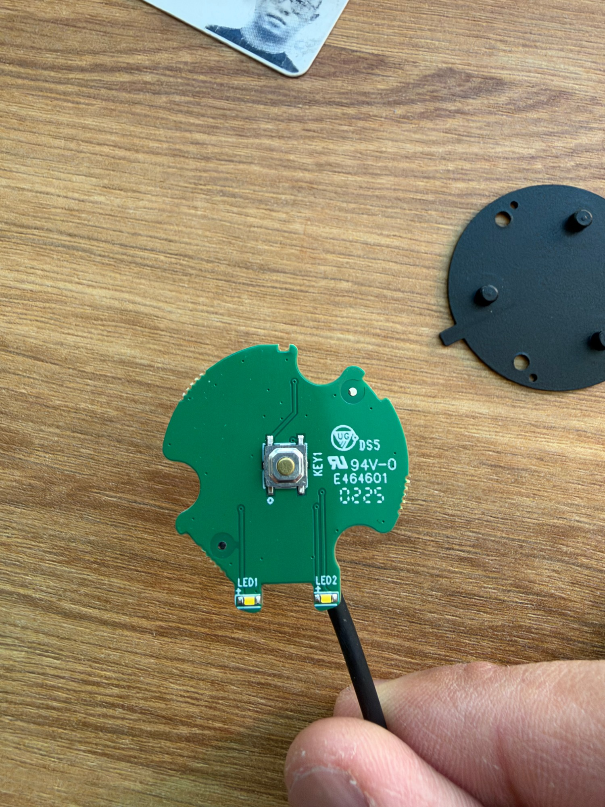
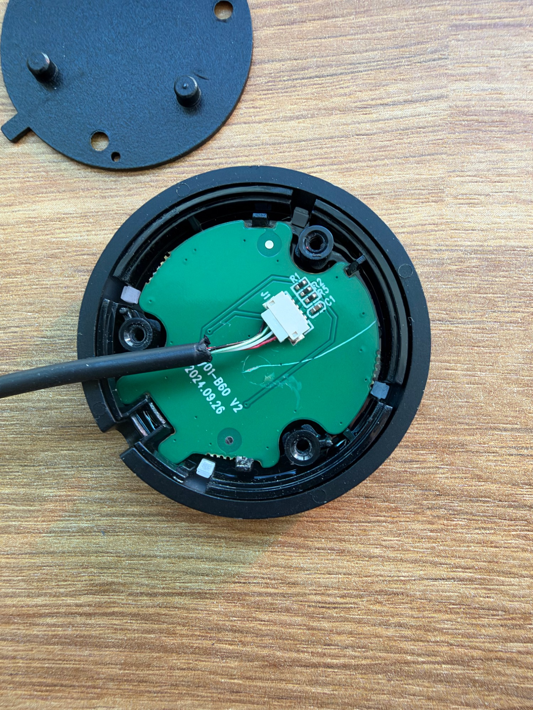

# Remote photos

Supplied by the owner on 2026-11-03:

## Switch and LED side

## Connector and passive-component side

These source photos establish visible components. Electrical connections are documented in the [schematic](../schematic.md) and [readings](../readings.md).
